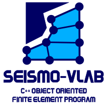

**Seismo-VLAB** (a.k.a **SVL**) is a simple, fast, and extendable C++ finite element software designed to optimize meso-scale simulations of linear and nonlinear wave-propagation and soil-structure interaction. **SVL** is intended not only to be used by researchers in structural and geothecnical engineering, but also in industries, laboratories, universities, etc.

* [Official website](http://www.seismovlab.com)
* [GitHub repository](https://github.com/SeismoVLAB/SVL)
* [Official documentation](http://www.seismovlab.com/documentation/index.html)

What can Seismo-VLAB do?
------------------------
With **Seismo-VLAB** you can solve:

* Linear and nonlinear wave propagation problems in shallow crust
* Linear and nonlinear soil-structure interaction problems
* Standard structural-mechanics linear and nonlinear dynamic problems

Visit our gallery to see some [examples](http://www.seismovlab.com/gallery.html) of simulations using **SVL**.

Installing Seismo-VLAB
----------------------
Installation of **Seismo-VLAB** on Linux/MacOS/Windows is perform in two steps: 


* The Pre-Process requires `python3` and the following libraries:
    * [Numpy](https://numpy.org/)
    * [Scipy](https://www.scipy.org/)
    * [Matplotlib](https://matplotlib.org/)
    * [JSON](https://www.json.org/json-en.html)
    
    These librarires can be installed using `pip3` or standard Linux and Mac repositories.

* The Run-Process requires requires to download `Eigen` C++ library, `MUMPS` Library, and `PETSc` Library.
    * The **Eigen C++ library** can be downloaded from this [website](http://eigen.tuxfamily.org/). This package needs to be unzip and its content move to `/usr/include/eigen`. 
    * The **MUMPS library** can be downloaded from this [website](http://mumps.enseeiht.fr/). This package needs to be unzip and compiled at `/usr/include/mumps`.
    * The **Pestc Library** can be downloaded at this [website](https://www.mcs.anl.gov/petsc/). This package needs to be unzip and compiled at `/usr/include/petsc`.
    
    Assuming the previous libraries are successfully installed, then modify the `Makefile.inc` file such the previous path point to the right libraries:
    ```makefile
    EIGEN_DIR = /usr/include/eigen
    PETSC_DIR = /usr/include/petsc
    MUMPS_DIR = /usr/include/mumps
    ```
    Also, make sure that libraries such as: *libscalapack-openmpi*, *libblacs-openmpi*, *liblapack*, *libblas*, and *libparmetis*, *libmetis*, *libptscotch*, *libptscotcherr* are also installed.

    Finally, write in terminal:
    ```bash
    make -s DEBUG=False
    ```

A detailed explanation on how to install **SVL** on Windows, MacOS, and Linux can be found in [this link.](http://seismovlab.com/documentation/linkInstallation.html)

License
=======

[](https://www.gnu.org/licenses/gpl-3.0)

**Seismo-VLAB** is free software: you can redistribute it and/or modify it under the terms of the GNU General Public License as published by the Free Software Foundation, either version 3 of the License, or (at your option) any later version.
**Seismo-VLAB** is distributed in the hope that it will be useful, but WITHOUT ANY WARRANTY; without even the implied warranty of MERCHANTABILITY or FITNESS FOR A PARTICULAR PURPOSE. See the GNU General Public License for more details http://www.gnu.org/licenses.

Citation
========
To cite Seismo-VLAB, please use :

Kusanovic, D. S., Seylabi, E. E., and Asimaki, D. Seismo-VLAB: An open-source finite element software for seismic meso-scale simulations. *SoftwareX*, Volume 21, 101300  [](https://doi.org/10.1016/j.softx.2022.101300)

```
@article{Kusanovic2022,
title = {Seismo-VLAB: An open-source finite element software for seismic meso-scale simulations},
journal = {SoftwareX},
volume = {21},
pages = {101300},
year = {2023},
issn = {2352-7110},
doi = {https://doi.org/10.1016/j.softx.2022.101300},
url = {https://www.sciencedirect.com/science/article/pii/S2352711022002187},
author = {Danilo S. Kusanovic and Elnaz Seylabi and Domniki Asimaki},
keywords = {Finite element software, Soil–structure interaction, Wave propagation, Meso-scale simulation, Perfectly matched layer, Domain reduction method, Domain decomposition, High-performance computing, Parallel computing, Object-oriented programming},
abstract = {We present Seismo-VLAB (SVL), a new open-source, object-oriented finite element software designed to optimize meso-scale simulations in the context of structural and geotechnical engineering. To this end, state-of-the-art tools and parallel computing capabilities required for efficient modeling of soil–structure interaction and wave propagation in heterogeneous half-spaces are included. For example, perfectly matched layer, domain reduction method, dynamic nonlinear solvers, cutting edge parallel linear system solvers, domain decomposition method, and a series of plasticity models are some of the features available in SVL. In this work, we present the numerical implementation and software structure so enthusiastic developers can contribute to this open-source project and showcase some software capabilities using an illustrative example.}
}
```

Kusanovic, D. S., Seylabi, E. E., Ayoubi, P., Nguyen, K. T., Garcia-Suarez, J., Kottke, A. R., & Asimaki, D. (2023). Seismo-VLAB: An Open-Source Software for Soil–Structure Interaction Analyses. *Mathematics*, 11(21), 4530. [](https://doi.org/10.3390/math11214530
)

```
@Article{Kusanovic2023,
AUTHOR = {Kusanovic, Danilo S. and Seylabi, Elnaz E. and Ayoubi, Peyman and Nguyen, Kien T. and Garcia-Suarez, Joaquin and Kottke, Albert R. and Asimaki, Domniki},
TITLE = {Seismo-VLAB: An Open-Source Software for Soil–Structure Interaction Analyses},
JOURNAL = {Mathematics},
VOLUME = {11},
YEAR = {2023},
NUMBER = {21},
ARTICLE-NUMBER = {4530},
URL = {https://www.mdpi.com/2227-7390/11/21/4530},
ISSN = {2227-7390},
ABSTRACT = {In the fields of structural and geotechnical engineering, improving the understanding of soil–structure interaction (SSI) effects is critical for earthquake-resistant design. Engineers and practitioners often resort to finite element (FE) software to advance this objective. Unfortunately, the availability of software equipped with boundary representation for absorbing scattered waves and ensuring consistent input ground motion prescriptions, which is necessary for accurately representing SSI effects, is currently limited. To address such limitations, the authors developed Seismo-VLAB (SVL v1.0-stable) an open-source software designed to perform SSI simulations. The methodology considers the integration of advanced techniques, including the domain decomposition method (DDM), perfectly matched layers (PMLs), and domain reduction method (DRM), in addition to parallel computing capabilities to accelerate the solution of large-scale problems. In this work, the authors provide a detailed description of the implementation for addressing SSI modeling, validate some of the SVL’s features needed for such purpose, and demonstrate that the coupled DRM–PML technique is a necessary condition for accurately solving SSI problems. It is expected that SVL provides a significant contribution to the SSI research community, offering a self-contained and versatile alternative. The software’s practical application in analyzing SSI and directionality effects on 3D structures under seismic loading demonstrates its capability to model real-world earthquake responses in structural engineering.},
DOI = {10.3390/math11214530}
}
```
